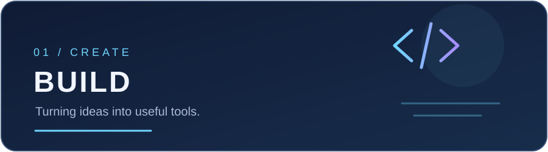
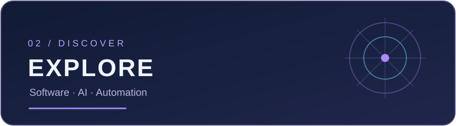
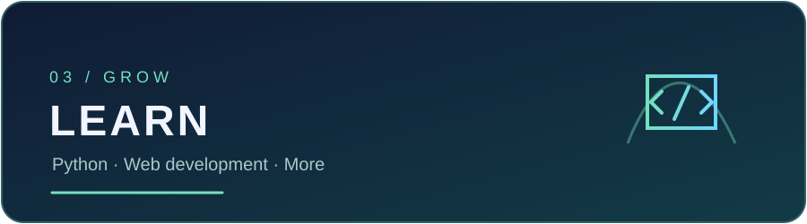

  

<h2 align="center">A space for building, exploring, and learning.</h2>

  I'm Youcef. I enjoy exploring software, practical ideas, and the ways technology can solve everyday problems.

---

  
  
  

## ◌ GitHub Overview

  
  

  

### ✦ BUILD
I work on small projects that turn ideas into useful tools.

**Featured project**
- [Business Process Manager](https://github.com/youveth/business-process-manager) — a Flask application for organizing business processes and workflows.

### ◈ EXPLORE
Interested in software, AI tools, automation, and digital products.

### ⌁ LEARN
Currently exploring Python, web development, and better ways to build software.

---

  BUILD · EXPLORE · LEARN

